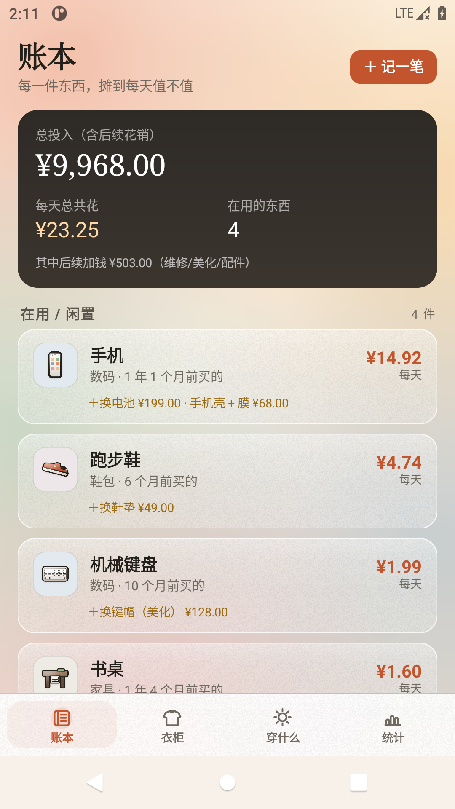
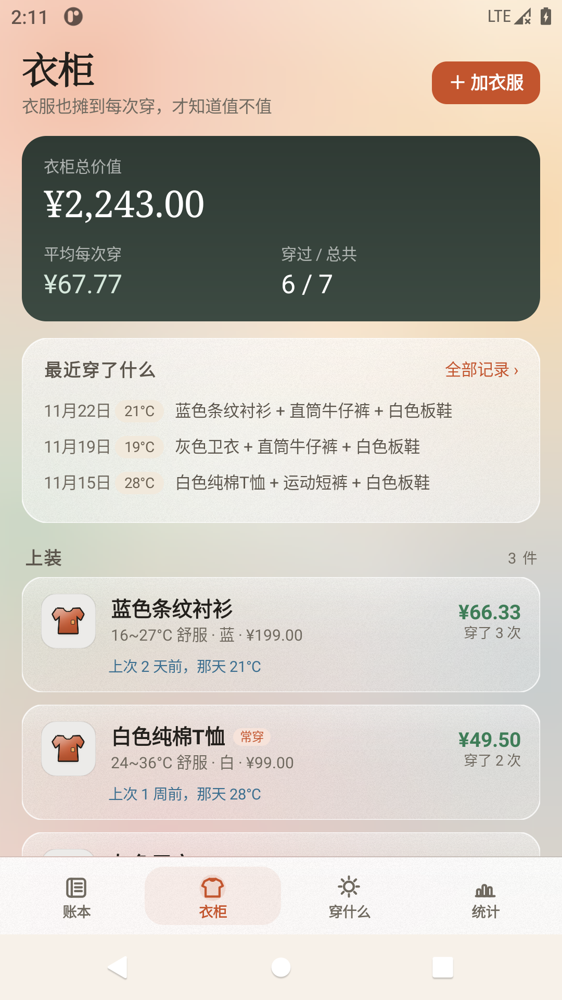
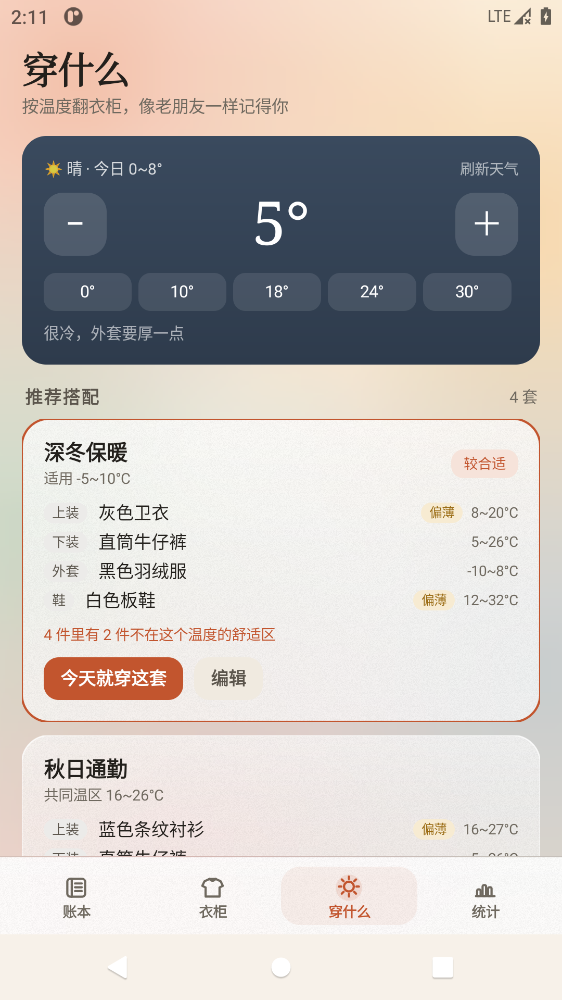
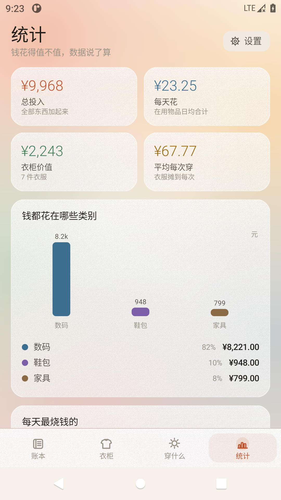
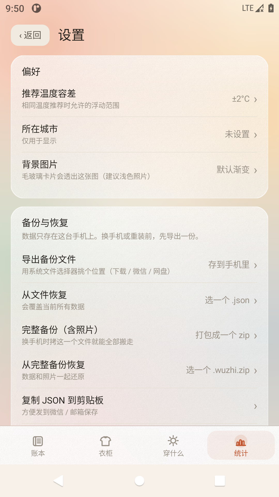
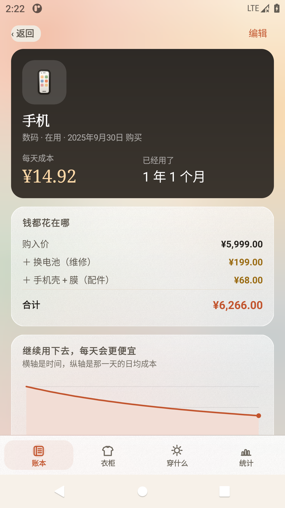
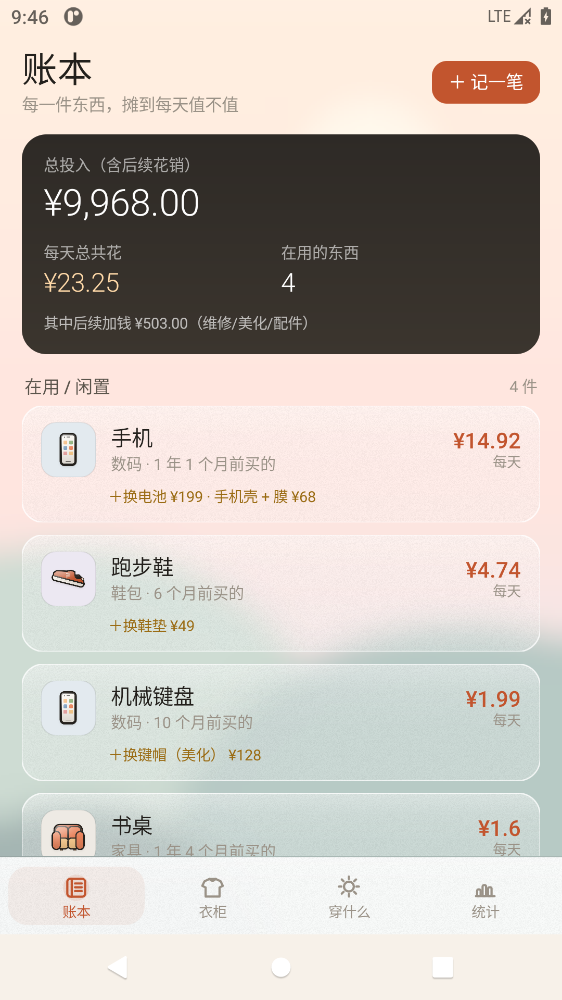

# 物资 · Wuzhi

一个用来回答两个问题的记账 App：

> **「这件东西，摊到每天还值不值？」**
> **「今天这个温度，该穿哪件？怎么搭？」**

单 Activity、纯 Java、零第三方依赖，直接调用 Android 系统控件；APK 只有 583 KB。



## 功能

### 账本（物品 + 日均成本）

- 记录每件东西的**购入价、购买日期、分类、备注**
- 自动算**平均每天成本** =（购入价 + 后续花销 − 卖出回收）÷ 已用天数
- **持续加钱**：维修、美化、配件、其他四类附加花销，随时往同一件东西上追加
- 状态流转：在用 / 闲置 / 报废 / 送人 / 卖出；报废后日均成本**冻结**在报废日，不会再被时间稀释
- 详情页有**未来一年日均成本下降曲线**，直观看到「再用久一点就更划算」
- 卖出回收价会从总成本里扣掉

### 衣柜（衣服 + 单次穿着成本）

- 记录每件衣服的**价格、购买日期、分类、厚薄、颜色、舒适温度区间**
- 每穿一次记一条**穿着记录**：日期、当天温度、天气、体感（1–5 星）
- 自动算**单次穿着成本** = 价格 ÷ 穿着次数
- 冷落提醒：多久没穿、是不是买亏了

### 穿什么（按温度推荐 + 搭配）

- 拨到今天的温度（或直接用上次记录的温度）
- **「这个温度你穿过」**：翻出同温度（±2°C，可调）下穿过的单品和整套搭配
- **推荐搭配**：已保存的搭配按温差排序，第一条高亮「最合适」
- **自动组合**：按上装 / 下装 / 外套 / 鞋 / 配饰逐个槽位打分，自动凑一套
- 打分考虑：温度贴合度、上次穿它时的温度、多久没穿、是否常穿、单次成本
- 一键「今天就穿这套」，自动写进穿着记录

### 统计 + 设置

- 总投入、每天花、衣柜价值、平均每次穿
- 分类占比、烧钱榜、追加花销结构、穿得最多、最不划算、每月花费
- **备份与恢复**：
  - 导出 / 恢复 JSON（走系统文件选择器，可存到下载、微信、网盘）
  - **完整备份 `.wuzhi.zip`**：数据 + 所有照片打成一个包，换手机只拷这一个文件
  - 复制 JSON 到剪贴板 / 从剪贴板恢复

### 界面

- **毛玻璃卡片**：按卡片在窗口里的真实位置裁一块模糊背景 → 白色 tint → 顶部高光 → 细噪点，滚动时背景跟随；没有引 Material / 第三方 UI 库，全部自绘（`Glass.java` + `GlassCard.java`）
- **自定义毛玻璃底图**：设置 → 背景图片 → 从相册选一张，整张图会被重度模糊后铺在卡片背后（可随时恢复默认渐变）
- 手绘矢量插画（19 张，按分类自动匹配），也可以**从相册选自己的照片**（自动压缩、转正、原子落盘）
- 暖纸色系 + 陶土橙强调色，页面切换淡入上浮

## 截图

| 账本 | 衣柜 | 穿什么 |
| --- | --- | --- |
|  |  |  |

| 统计 | 设置 | 物品详情 |
| --- | --- | --- |
|  |  |  |

| 自定义毛玻璃底图 |
| --- |
|  |

## 安装

1. 下载 [Releases](../../releases) 里的 `wuzhi.apk`
2. 传到手机（微信文件传输 / 数据线 / 网盘都行）
3. 点击安装，系统提示「未知来源」时允许一次

要求 Android 7.0（API 24）及以上。首次打开会灌入一份示例数据，可在「设置 → 清空数据」里清掉。

## 构建

不用 Gradle，不联网，一条脚本搞定：

```bash
# 需要 JDK 17 + Android SDK build-tools 36.0.0 / platform android-35
bash build.sh
```

`build.sh` 依次执行：`aapt2 compile` → `aapt2 link` → `javac -source 8 -target 8`（`-bootclasspath` 前置 `core-lambda-stubs.jar` 以支持 lambda）→ `d8` → 把 `classes.dex` 塞进 APK → `zipalign` → `apksigner sign`（v1+v2）→ `apksigner verify` + `aapt2 dump badging`。

> 签名用的是仓库外的 `wuzhi.keystore`（已在 `.gitignore` 里排除）。自己构建时先生成一份：
> `keytool -genkeypair -keystore wuzhi.keystore -storepass wuzhi123 -keypass wuzhi123 -alias wuzhi -keyalg RSA -keysize 2048 -validity 10000 -dname "CN=Wuzhi"`

## 测试

核心逻辑（金额、日期、日均成本、推荐打分、JSON 存取）有一份纯 JVM 单测，不需要模拟器：

```bash
javac -encoding UTF-8 -d out/core $(find app/src/com/wuzhi/core -name "*.java") test/CoreTest.java
java -cp out/core CoreTest      # RESULT: 59 passed, 0 failed
```

## 代码结构

```
app/src/com/wuzhi/
├── App.java                  Application：Store 单例 + 原子落盘 + 导入导出
├── Backup.java               zip 完整备份（json + photos）
├── core/                     纯 Java，无 Android 依赖，可跑单测
│   ├── Json.java             手写 JSON 解析/生成
│   ├── DateUtil.java         Calendar + epoch day
│   ├── Fmt.java              金额（整数分）格式化
│   ├── Item.java             物品：totalFen / netFen / usedDays / dailyFen / costTimeline
│   ├── CostEntry.java        附加花销
│   ├── Cloth.java            衣物：温度区间 / 单次成本 / distanceTo
│   ├── WearLog.java          穿着记录
│   ├── Outfit.java           搭配（槽位 → 衣服）
│   ├── Recommender.java      推荐打分 / 按槽位排名 / 自动组合
│   ├── Store.java            四张表 + CRUD + 统计重算 + demo 数据
│   └── Stats.java            统计聚合
├── core/PhotoStore.java      照片：导入压缩到 1600px、EXIF 转正、原子落盘
└── ui/
    ├── MainActivity.java     单 Activity + 4 Tab + 系统返回键处理
    ├── Ui.java               dp / 圆角 / 卡片 / 按钮 / chip 等控件工厂
    ├── Glass.java            毛玻璃底：模糊渐变 + 光斑 + 噪点
    ├── GlassCard.java        毛玻璃卡片（BitmapShader + 滚动重绘）
    ├── Glyph.java            手绘 tab 图标
    ├── Art.java              分类插画 + 自定义照片头像
    ├── Sheet.java            底部弹层（输入 / 金额 / 日期 / 自动换行 chips）
    ├── ChartView.java        Canvas 折线图 / 柱状图
    ├── ItemsPage / ClosetPage / SuggestPage / StatsPage / SettingsPage
    └── PhotoPicker.java      相册选图（SAF，无需存储权限）
```

## 在电脑上看界面

不用装 Android Studio，三种办法：

1. **第三方模拟器（最省事）**：装 MuMu 12 / 雷电，装好后在命令行 `adb connect 127.0.0.1:16384`（MuMu）或 `127.0.0.1:5555`（雷电），再 `adb install -r wuzhi.apk`，窗口里就是真实渲染。
2. **官方 emulator（本仓库验证用的就是它）**：
   ```bash
   emulator -avd <你的AVD> -no-window -no-audio -no-boot-anim -gpu host -accel on
   adb install -r wuzhi.apk
   adb shell am start -n com.wuzhi/.ui.MainActivity
   adb exec-out screencap -p > shot.png
   ```
   `-gpu host` 是关键：`swiftshader_indirect` 会 0xC0000005 崩溃、`-gpu off` 会卡在开机。
3. **真机 + scrcpy**：手机开 USB 调试，`scrcpy` 把画面投到电脑，可以直接用鼠标操作。

`docs/screenshots/` 里的 6 张就是模拟器 1080×1920 的真实截图。

## 数据

所有数据只存在手机本地：`getFilesDir()/wuzhi.json`，照片在 `getFilesDir()/photos/`。
没有网络请求，没有账号，不上传任何东西。
